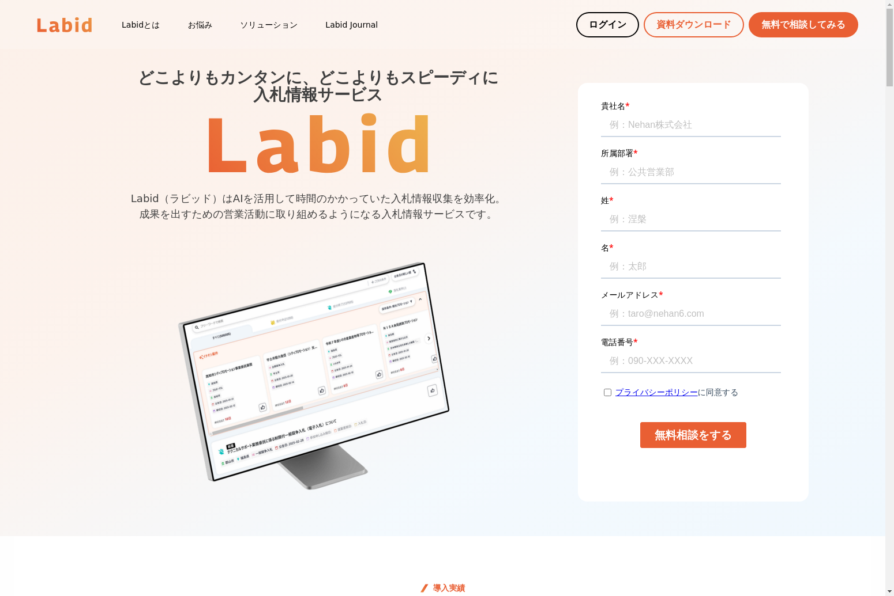
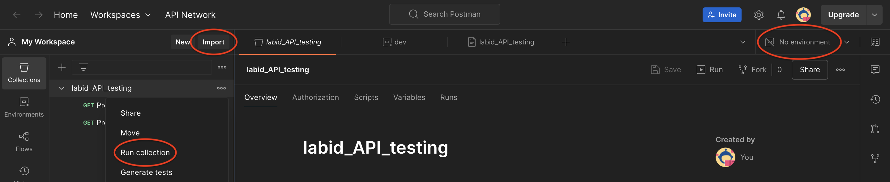

# labid
## このレポジトリについて
### ディレクトリの構成
```
Labid/
├── admin/             # 管理画面
├── client/            # 旧UI
├── doc/               # README や actions で使用する素材が入っています
├── new_client/        # 新UI(nextjs)
├── server/            # バックエンド(rails)
├── docker-compose.yml
├── lefthook.yml
├── openapi.yml
└── README.md
```

### バックエンド
[バックエンドの説明](server/README.md)

### アプリ画面

### 管理画面

## Getting Started

### 1. Check out labid

```sh
$ git clone git@github.com:Nehan-Inc/labid.git
```

### 2. Set environment variables
秘匿情報は空にしています。
DMでお渡しするので誰かに声かけてください。
```sh
$ cp ./server/.env.sample ./server/.env
$ cp ./new_client/.env.sample ./new_client/.env
$ cp ./agent/project_chat/.env.sample ./agent/project_chat/.env
```

## 新入社員向け環境構築ガイド

このセクションでは、新しく入社したエンジニアがLabidの開発環境を構築するための詳細な手順を説明します。

### 開発用ユーザーの作成

誰かに開発環境向けのAuth0で開発用ユーザーを作成してもらってください。メールアドレスはご自身のものを使用してください。(※登録したメールアドレスは環境変数に設定するので控えておいてください)

### バックエンド環境の構築

#### 1. 環境変数の設定

バックエンドの`.env`ファイルには以下の項目を設定する必要があります。具体的な値は先輩エンジニアに確認してください。

```
# server/.env に設定する主な環境変数
AWS_ACCESS_ID=           # AWSアクセスID
AWS_ACCESS_KEY=          # AWSアクセスキー
DATABASE_HOST=db         # データベースホスト（通常はdb）
DATABASE_USERNAME=       # データベースユーザー名
DATABASE_PASSWORD=       # データベースパスワード
OPENAI_API_KEY=          # OpenAI APIキー
AUTH0_DOMAIN=            # Auth0ドメイン
AUTH0_AUDIENCE=          # Auth0オーディエンス
AUTH0_BACKEND_CLIENT_ID= # Auth0バックエンドクライアントID
AUTH0_BACKEND_CLIENT_SECRET= # Auth0バックエンドクライアントシークレット
DEV_USER_EMAIL=          # Auth0で登録した開発用ユーザーのメールアドレス
```

#### 2. Dockerコンテナの起動

バックエンドサービスはDockerコンテナで実行されます。以下のコマンドでコンテナを起動します。

```sh
$ cd labid
$ docker compose build  # 初回のみ必要
$ docker compose up -d  # バックグラウンドで実行
```



#### 3. コンテナの状態確認

コンテナが正常に起動しているか確認します。

```sh
$ docker compose ps
$ docker compose logs app
```

#### 4. データベースの初期化

初回起動時は、以下のコマンドでデータベースを初期化してSeedデータを投入します。
Auth0で登録したメールアドレスとパスワードでログインできるLabidのユーザーが自動的に作成されます。
`server/.env`ファイルで`DEV_USER_EMAIL`が設定されている必要があります。

```sh
$ docker compose exec app make db-setup
```

### フロントエンド環境の構築

#### 1. 環境変数の設定

フロントエンドの`.env`ファイルには以下の項目を設定する必要があります。具体的な値は先輩エンジニアに確認してください。

```
# new_client/.env に設定する主な環境変数
NEXT_PUBLIC_API_URL=     # APIのURL（通常はhttp://localhost:3000）
NEXT_PUBLIC_AUTH0_DOMAIN= # Auth0ドメイン
NEXT_PUBLIC_AUTH0_CLIENT_ID= # Auth0クライアントID
```

#### 2. パッケージのインストールとアプリの起動

フロントエンドアプリケーションを起動するには以下のコマンドを実行します。

```sh
$ cd new_client
$ yarn install  # 依存パッケージのインストール（huskyのセットアップも行われます）
$ yarn dev      # 開発サーバーの起動
```

起動が完了すると、以下のようなメッセージが表示されます。

```
yarn run v1.22.xx
$ next dev -p 8080
   ▲ Next.js 14.x.x
   - Local:        http://localhost:8080
   - Environments: .env

 ✓ Ready in xxxms
```

ブラウザで http://localhost:8080 にアクセスすると、Labidのフロントエンド画面が表示されます。


#### 3. Git Hooksの設定

プロジェクトではlefthookを使用してgit hooksを設定しています。以下のコマンドでインストールしてください。

```sh
$ brew install lefthook  # Macの場合
$ lefthook install
```

この際、client/.husky/_ にファイルが作成される場合は、以下のコマンドでpathのリセットを行なってください。

```sh
$ git config --unset core.hooksPath
```

## API Documents
### 確認方法
```sh
$ docker compose up swagger-ui
```

swagger-ui を起動しAPIドキュメントの確認ができます

```sh
$ open http://localhost:8082
```

### 編集方法
openapi.yml を stoplight を用いて編集する。
またこのファイルを編集後、以下のコマンドを実行する。
```sh
$ yarn orval
```

## ECS Execの使い方

awscliをインストールし、credentialファイルを作成します
```sh
$ brew install awscli
```

|     file_path      |                                                value                                                |
| :----------------: | :-------------------------------------------------------------------------------------------------: |
| ~/.aws/credentials | [labid]<br>aws_access_key_id=${AWS Access Key ID}<br>aws_secret_access_key=${AWS Secret Access Key} |
|   ~/.aws/config    |                                 [default]<br>region=ap-northeast-1                                  |

- スクリプトを実行(オプションでコンテナ名と環境を指定します)
  - -c: コンテナ名(server)
  - -e: 環境(dev, prod)

```sh
$ ./server/scripts/ecs_exec.sh -c server -e dev
```

## BE テストカバレッジ計測
### 計測ツール
[simplecov](https://github.com/simplecov-ruby/simplecov)

実行された命令分の割合をファイル毎に出力する

### 確認方法
サーバー開始後に docker 上でテストを実行する
```bash
$ docker compose exec app bash
$ RAILS_ENV=test bundle exec rspec
```

上記実行後、server/coverage にレポートが作成されている

## Postman テストの実行について
.github/postman　配下に[Postman](https://www.postman.com/product/what-is-postman/?deviceId=a9cf2580-c4a6-472c-8894-561d0f8bf2c2)のテストのコレクションと環境がある。これはdaily_api_test_devのアクションで毎日Githubで実行される
### CLI での実行
このテストをローカルCLIで以下のように実行する
```
npm install -g newman
cd .github/postman
newman run labid_API_testing.postman_collection.json -e dev.postman_environment.json
```
### GUI での実行
このテストを以下の手順でPostmanアプリ上にインポートして実行できる。
1. Postmanアプリを開き、左サイドバーにある`Import`ボタンを押し、`labid_API_testing.postman_collection.json`と`dev.postman_environment.json`を追加する。
2. 画面の右上から環境を設定し、環境変数を使う。（環境未設定の場合に`No environment`が表示される）
3. `Run collection`を押して実行する。



## アカウント連携機能について

- ローカル/開発環境で動作確認を行う場合、Google Cloud 側の設定が必要となるため、池水に相談してください
- 下記環境変数を適切に設定してください(server/.env)

設定項目
```
FRONTEND_BASE_URL=
GOOGLE_CLIENT_ID=
GOOGLE_CLIENT_SECRET=
GOOGLE_CALENDAR_WEBHOOK_URL=
```

## ローカル環境でおすすめ案件のレコメンドを使用するための操作

- おすすめ案件のレコメンドは事業内容のembeddingを使用しているため、LLMを使用できる状態で事業内容のデータを作成する必要があります

1. 環境変数の設定
- .envに以下の変数を設定する(値については管理者にお問い合わせください)
```
AZURE_OPENAI_API_KEY=
AZURE_OPENAI_API_VERSION=
```

2. 事業内容のデータ作成
- 画面操作にて事業内容のデータを作成する

3. おすすめ案件のレコメンドを使用する
- 画面操作にておすすめ案件のレコメンドを使用する

## PR review 依頼するときの心得
PR を作成し review を依頼する際には 以下の github actions が成功しており review が可能な状態になっていることを確認してください
1. Server / RSpec
2. Server / Rubocop
3. client


これらをローカルで確認するためには以下のコマンドを使用します。
### rspec の実行
コンテナ上での実行を前提にしているため、labid-app-1 上で以下を実行する
```sh
$ RAILS_ENV=test bundle exec rspec
```

*上記実行時に table doesn't exist みたいなエラーが発生する場合がある。Getting started 4 を参考に以下を実行する
```sh
$ RAILS_ENV=test docker compose run --rm app rails db:create
$ RAILS_ENV=test docker compose run --rm app bundle exec rake ridgepole:apply
$ RAILS_ENV=test docker compose run --rm app rails elasticsearch:update_index:project
$ RAILS_ENV=test docker compose run --rm app rails elasticsearch:update_index:awarded_project
```
### rubocop の実行
コンテナ上での実行を前提にしているため、labid-app-1 上で以下を実行する
```sh
$ RAILS_ENV=test bundle exec rubocop
```

### client
new_client 内で
```sh
$ npm run build
```

## CI/CDについて
### client_ci.yml
- 実行タイミング
  - Pull Request 作成時および更新時に以下のファイルに変更があった場合
    - `new_client/**`
    - `.github/workflows/client_ci.yml`
- 処理内容
  - クライアント側のコードのビルドを行う

### daily_api_test_dev.yml
- 実行タイミング
  - 毎朝 9:00 に定期実行、もしくは手動実行
- 処理内容
  - postman のapiテストセットを実行し、discord に通知する

### github_deployment_dev.yml
- 実行タイミング
  - master ブランチへの push、もしくは手動実行
- 処理内容
  - client, admin, server をそれぞれのテスト環境にデプロイする

### github_deployment_prod.yml
- 実行タイミング
  - github のリリースノート新規作成時
- 処理内容
  - client, admin, server をそれぞれの本番環境にデプロイする

### server_ci.yml
- 実行タイミング
  - Pull Request 作成時および更新時に以下のファイルに変更があった場合
    - `**.rb`
    - `Gemfile.lock`
    - `**.yml`
    - `.github/workflows/server_ci.yml`
- 処理内容
  - RSpec および Rubocop を実行する

## E2Eテスト( Claude Code with Playwright MCP )について
### セットアップ
- `playwright_e2e/.info.json` にログイン情報を設定
  - `LABID_LOGIN_EMAIL`: ローカル環境でLABIDにログインする際に使用するメールアドレス
  - `LABID_LOGIN_PASSWORD`: ローカル環境でLABIDにログインする際に使用するパスワード

### 実行方法
1. Claude Codeを起動(初回のみ、MCPの利用を許可する必要があります)
2. `/project:playwright_e2e` コマンドを実行
3. `playwright_e2e/output/result.md` にテスト結果が出力されます

### 使用可能オプション
- `--capture`: スクリーンショットオプション
  - 各テスト項目の実施後にスクリーンショットを取得し、 `playwright_e2e/output/screenshots` に保存

### テスト項目の追加方法
- `.claude/commands/playwright_e2e.md` にテスト項目を追加

### ヘッドレスモードについて
- デフォルトでは、ヘッドレスモードで実行されます。
- ヘッドレスモードを無効にするには、**Claude Codeの起動前**に `playwright_e2e/.config.json` の `browser.launchOptions.headless` を `false` に設定する必要があります。

## Tips && FAQ
### api スキーマの整合性チェックについて
本プロジェクトでは、Committee::Rails という gem を利用して、openapi.yml に定義されたスキーマに基づき API のリクエストおよびレスポンスのスキーマ整合性を検証しています。
このため、rspec 内でのレスポンスの値チェック等は行っていません。

## 環境構築でよくある問題と解決策

### Dockerの起動に関する問題

#### データベースの起動失敗
Linuxでローカルのmysqlが実行されている場合は停止が必要です：
```sh
$ sudo systemctl status mysql
$ sudo systemctl stop mysql
```

#### Linuxでのプラットフォーム問題
docker-compose.ymlのdb設定を修正します：
```diff
platform: linux/arm64/v8 → platform: linux/amd64
```

### ElasticSearchの問題

#### 起動失敗
Linuxの場合、docker-compose.ymlから以下の行を削除してみてください：
```
  - 'ES_JAVA_OPTS=-XX:UseSVE=0'
  - 'CLI_JAVA_OPTS=-XX:UseSVE=0'
```

#### メモリ不足
定期的にDockerのキャッシュをクリアしましょう：
```sh
$ docker system prune -a
```

### その他の一般的な問題

#### Node.jsのバージョン不一致
フロントエンドの起動に失敗する場合、Node.jsのバージョンを確認してください：
```sh
$ node -v
```
package.jsonで指定されているバージョンと一致していない場合は、nvmを使用して適切なバージョンをインストールしてください：
```sh
$ nvm install 16  # 例: Node.js v16をインストール
$ nvm use 16      # Node.js v16を使用
```

#### ポートの競合
すでに使用されているポートでアプリケーションを起動しようとすると失敗します。以下のコマンドで使用中のポートを確認できます：
```sh
$ lsof -i :3000  # バックエンドポート
$ lsof -i :8080  # フロントエンドポート
```
